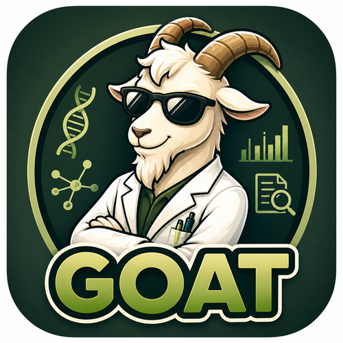

  

# 🐐 GOAT

**investiGating biOlogical insights And hypoThesis**

GOAT is an AI agent that takes a gene list from any omics experiment and turns it into a cited, context-aware research report. It queries public biomedical databases for every gene, summarises the literature with a large language model (LLM), and then reasons across the whole gene set to suggest pathways, therapeutic opportunities, experiments and a ranked list of targets.

GOAT is available as a hosted web app at [mountaingoat.bihealth.org](https://mountaingoat.bihealth.org/), or you can run it yourself from this repository.

## Why GOAT exists

Most omics analyses end the same way, with a list of statistically significant hits. Working out what those hits mean is slow. For each gene you search Google, open NCBI Gene, UniProt, GeneCards and the Protein Atlas, then look for papers that link the gene to your disease or tissue. After a few dozen genes, the tabs, copy-pastes and fatigue start to limit how deeply you can look at the rest.

GOAT automates that repetitive querying so researchers have more time for the hard part, which is thinking about the biology.

## What it does

For each gene, GOAT collects the following.

| Source | Query | What GOAT retrieves |
| :---- | :---- | :---- |
| NCBI Gene | Gene symbol + organism | Official name, RefSeq summary, Ensembl ID |
| UniProt | Gene symbol + organism | UniProt accession, GO Biological Process terms (experimental evidence codes only), Reactome pathways |
| PubMed + iCite | Gene symbol + optional context | Abstracts, ranked by citation count, with automatic widening of the year window when hits are sparse |
| OpenTargets | Ensembl ID | Top disease associations and scores |
| ChEMBL | UniProt accession | Known drugs, mechanism of action, approval or clinical phase |
| ClinicalTrials.gov | Gene symbol + protein name + optional context | Recruiting and active trials, phase, sponsor, primary endpoint, estimated completion |
| GWAS Catalog | Gene symbol | SNPs (rsID), traits, p-values, effect sizes, study accessions |

The LLM then writes a per-gene literature summary in which every sentence carries a PubMed citation, and the prompts forbid citing anything outside the retrieved abstracts.

### Cross-gene synthesis

After the per-gene step, four chained LLM modules analyse the gene set as a whole. Each module receives the full results table plus the output of the modules before it, and each takes on a role tuned to your study context (for example "working with mouse, in the context of fibrosis of the liver").

| Module | Role | Output |
| :---- | :---- | :---- |
| Literature Synthesis | Cell biologist | Key pathways, upstream drivers vs. downstream effectors, cross-gene interactions, confidence and caveats, plus a compact summary table |
| Therapeutic Landscape | Drug discovery scientist | Ranked targets based on drugs, trials, disease associations and GWAS, flagged as potentially novel or underexplored |
| Experimental Proposal | Experimental biologist | Falsifiable hypotheses and proposed experiments with model system, perturbation and readout |
| Target Prioritisation | Drug discovery scientist | Final integrated High / Medium / Low ranking of targets |

### Outputs

Results are shown in tabs inside the app and can be downloaded as a CSV table and as a self-contained HTML report. A session file (.json) lets you reload results later without rerunning the pipeline.

## Running GOAT

### Requirements

You need an LLM API key, a gene list and an organism. Genes can be typed in directly or uploaded as a ranked CSV (gene symbol in column 1, a score such as logFC or p-value in column 2), in which case the ranking is passed to the LLM as extra context.

Everything else is optional. You can add disease, organ and free-text context, choose how many abstracts to pull per gene and from which years, switch database and LLM modules on or off, and decide which context fields are used in PubMed, ClinicalTrials.gov and LLM queries. An NCBI API key raises the NCBI rate limit from 3 to 10 requests per second.

### LLM providers

GOAT ships with presets for Groq, OpenAI and Anthropic, plus a **Custom** option for any OpenAI-compatible endpoint. The Custom option is how you point GOAT at a model running on your own hardware (for example through Ollama, vLLM or LM Studio). Groq's free tier is enough to try GOAT out, at roughly five full runs per day with llama-3.3-70b-versatile.

Two profiles are available. **Billy (Guided)** gives a short provider list with sensible defaults. **Mountain Goat (Explorer)** exposes every provider, custom model names, your own NCBI key, and per-module temperature and thinking settings.

## Keeping your data local

Commercial AI services see every query sent to them, and for unpublished hypotheses or sensitive projects that may not be acceptable. Open-weight models such as Llama, Mistral and Qwen are released under permissive licences, perform competitively on biomedical tasks, and can run on commodity hardware.

Because GOAT talks to any OpenAI-compatible endpoint, you can pair it with a locally hosted open-weight model. In that setup your gene lists, context and LLM prompts stay on your own machine or institutional network. The only outbound traffic is the database lookups themselves, which go to public APIs (NCBI, UniProt, OpenTargets, ChEMBL, ClinicalTrials.gov, GWAS Catalog).

## Limitations

LLM output varies with the model you choose, and models can hallucinate. GOAT reduces this by restricting citations to retrieved abstracts and by asking every synthesis module to state its confidence and gaps, but all synthesis output should be checked against the cited sources before you act on it.

Results depend on the coverage and uptime of the underlying databases. The sidebar includes a connectivity check for each API. NCBI, PubMed and UniProt are critical for a run; the other sources are optional.

GOAT is under active development, so expect rough edges and changes.

## Authors

Dr. Robert Lorenz Chua, Foo Wei Ten and Leonard Tiling

Intelligent Imaging, Center for Digital Health, Berlin Institute of Health at Charité

Thanks to Leonard Tiling for his work on the LLM synthesis prompts and to Foo Wei Ten for the de.NBI Cloud deployment.

## Feedback

Bug reports, feature ideas and test runs on your own data are very welcome. Please open an issue on GitHub.
